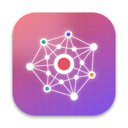

<p align="center"></p>

<h1 align="center">Loom</h1>

<p align="center"><b>A private second brain for iPhone, iPad and Mac, with all the AI on your device.</b><br>
Save notes, links, photos, videos, PDFs and files, and Apple Intelligence titles, summarizes and tags each one. Search by meaning, ask questions of your library, and watch your ideas form a web.</p>

<p align="center"><a href="#build-and-run">Build and run</a> · <a href="#install-on-your-mac">Install on your Mac</a> · <a href="#sharing-one-library-between-mac-and-iphone-icloud">iCloud sync</a></p>

Loom is a personal take on [Fabric](https://apps.apple.com/us/app/fabric-your-second-brain/id6449003046). Everything runs on Apple's on-device Foundation Model, so nothing you save leaves your devices. There are no accounts, no servers and no API keys.

## What it does

- **Save anything.** Notes, links (Loom fetches the page text), photos and screenshots (read with on-device OCR), videos (speech transcribed on the device, plus any text shown on screen), PDFs (text, and OCR for scans) and any other file. Add things from the + menu, by pasting (⌘V on Mac), or by drag and drop. Drop in as many as you like: they're copied in one at a time and read a couple at a time, so the app stays responsive, and anything still being added when you quit is finished on the next launch. The status dot at the top right lists each file's progress; a file that fails stays there with Retry and Remove buttons. Apple Intelligence streams each answer as it writes it, so a slow answer on a busy Mac is left to finish; if it goes silent for two minutes on an item, it's paused for a minute and that item goes back in line, and only if it hangs on the same item again is the item marked failed (Retry runs it again). One stuck call can't leave everything else at "Queued for summary…". Add a file whose name is already in your library and Loom asks whether to replace the copy it has (its space, tags and favorite are kept) or skip the file; if the earlier copy never finished adding, say after the app was quit mid-upload, it says so. **Clean up** (in the status panel, and in **Settings → Library**) removes every broken file at once: copies that never finished, items whose file is missing from this device and from iCloud, and items that hang off nothing on the map (no tags and no space: the loose grey dots). It names them and asks first, and leaves alone anything being added or organized right now, or added in the last hour and still waiting for Apple Intelligence (an item stuck waiting longer than that is fair game, so one press clears them all). With auto-organize off, or while Apple Intelligence isn't available, nothing would tag an item, so untagged items aren't counted as broken. **Undo** (in the status panel, in **Settings → Library**, and **Edit → Undo Last Add**, ⌥⌘Z, on the Mac) takes out the files that were added together most recently: one drop, one pick from Files or Photos, one paste. It names them and asks first, stops any that are still being copied in or read, and works once per batch, until the app is quit. Files a batch replaced aren't brought back.
- **Auto-organize.** Apple Intelligence writes a title, a summary of one to three sentences and topic tags for each item. It reuses the tags you already have, so they stay consistent.
- **Semantic search.** Search matches meaning as well as keywords. It uses Apple's built-in sentence embeddings, so it works offline even without Apple Intelligence.
- **Ask your library.** Chat with what you've saved. Answers come from your items and cite them as `[1]`, `[2]`, and each source is a link you can tap. Chats are kept.
- **The knowledge web.** A live map of your library: tags and spaces are concepts, your items hang off them, and the whole thing settles into shape as you save more.
- **Spaces and tags.** Folders ("Spaces"), automatic tags, favorites, and filters by type.
- **Shortcuts and Siri.** "Save to Loom", "Ask Loom", "Search Loom", "Open Item" and "New Note" work from the Shortcuts app, Siri and Spotlight.
- **Eleven themes.** Pick one in **Settings → Theme**: the original Loom and ten design languages (Paper & Ink, Herbarium, Observatory, Blueprint, Terrazzo, Swiss Index, Kiln, Lamplight, Riso, Mist). Each is a whole language in light and dark mode: colours, display, body and label type, corners, tile depth, icon weight, motion, and its own look for the map, from underlined words on ruled paper to stars in a night sky or frosted pills in mist. Kiln is the default.
- **One library everywhere.** With iCloud set up, the Mac and the iPhone share one library through your private iCloud database.

## Requirements

- Xcode 26 or newer, on an Apple silicon Mac.
- iOS 17+ or macOS 14+ to run the app. Organizing and Ask need **iOS 26 or macOS 26 on a device with Apple Intelligence turned on**. Without it, saving, search and the map still work.

## Build and run

`Loom.xcodeproj` is checked in, so just open it:

```bash
open Loom.xcodeproj
```

1. Select the **Loom-iOS** or **Loom-macOS** target, go to **Signing & Capabilities**, and check the Team. The project uses the paid team `66BLLM3ERE` with iCloud sync on. To build with a free Apple ID, pick your own team and point `CODE_SIGN_ENTITLEMENTS` back at the plain `Loom-iOS.entitlements` / `Loom-macOS.entitlements` (a free team can't sign iCloud).
2. Press ⌘R.

If you change `project.yml`, regenerate the project with `brew install xcodegen` (one time) and `xcodegen generate`.

On iPhone, apps sideloaded with a free Apple ID expire after 7 days; run again from Xcode to refresh. A paid developer account lasts a year.

### Keyboard (Mac)

| Key | Does |
| --- | --- |
| `⌘N` | New note |
| `⇧⌘L` | Save a link |
| `⌘V` | Paste anything into the library |
| `⌥⌘Z` | Undo the last batch of added files |
| `⌘,` | Settings |

## Install on your Mac

Double-click **Install Loom.command** in the repository folder in Finder. It gets the latest Loom from GitHub, builds it, installs it in /Applications with iCloud sync on, and opens it. After that, open it from the Dock, Launchpad or Spotlight like any other app. To update, double-click it again.

It always installs the latest `main`. Edits made on the Mac are put aside in a git stash (`git stash pop` brings them back), and commits that aren't on GitHub are kept on a `loom-backup-…` branch. Offline, it installs the copy that's there. For updates to work, get the folder with `git clone https://github.com/bollineni-create/blank.git` rather than as a zip.

The same build from Terminal, without the update step:

```bash
./scripts/install-mac.sh               # builds, installs /Applications/Loom.app and opens it
./scripts/install-mac.sh --no-install  # builds only, into build/
```

It signs with the project's team (`66BLLM3ERE`) and turns on iCloud, so the installed app shares one library with the iPhone. For a different team, use `LOOM_TEAM=<team id> ./scripts/install-mac.sh`. To build without any team (ad-hoc signed, no iCloud, its own library), use `LOOM_TEAM= ./scripts/install-mac.sh`.

## Sharing one library between Mac and iPhone (iCloud)

The library syncs through your private iCloud database (container `iCloud.com.bollineni.loom`). If that isn't set up, each device quietly keeps its own library. **Settings → iCloud sync** on each device shows whether sync is on, and if not, why.

For sync to work you need:

1. **A paid Apple Developer Program team.** A free Apple ID can't sign apps with iCloud. Both targets use team `66BLLM3ERE` with the `-iCloud` entitlements; with a free team, switch `CODE_SIGN_ENTITLEMENTS` in `project.yml` back to the plain files and run `xcodegen generate`.
2. **The same team on both targets.** In **Signing & Capabilities** for **Loom-iOS** and **Loom-macOS**, choose the same team and check that the **iCloud** capability lists `iCloud.com.bollineni.loom` on both. Container names are unique across all developers; if Xcode says it's taken, pick another (for example `iCloud.com.yourname.loom`) and change it in both `-iCloud` entitlements files and in `SyncMonitor.containerID`.
3. **The same Apple Account** signed in to iCloud on the Mac and the iPhone.
4. **The same iCloud environment.** Builds run from Xcode use *development*; TestFlight and App Store builds use *production*. The two never see each other's data, so run both from Xcode, or ship both through TestFlight after deploying the schema in the CloudKit Console.

The first sync can take a few minutes, and large attachments take longer. The iOS Simulator only syncs when the app opens, because it gets no push notifications.

## How it's put together

```
Loom/
  App/LoomApp.swift             app entry, SwiftData container, Mac menu commands
  Models/Item.swift             Item, Space, Conversation, ChatMessage (SwiftData)
  Intents/LoomIntents.swift     Shortcuts, Siri and Spotlight actions
  Services/
    LLMService.swift            Apple Intelligence availability and streaming generation
    AppleModelEngine.swift      Foundation Models calls (plain answers and guided organizing)
    Librarian.swift             saving items and the background organizing queue
    ContentExtractor.swift      link fetching, HTML to text, Vision OCR, PDF text, video transcripts, thumbnails
    SearchIndex.swift           NLEmbedding vectors plus keyword hybrid ranking
    AttachmentStore.swift       copies of imported files
    SyncMonitor.swift           whether iCloud sync is running, and why not
  Theme/                        design tokens and the eleven themes
  Views/                        sidebar, library grid, item detail, Ask chat, knowledge web, settings
  Resources/                    icons, bundled fonts, entitlements
project.yml                     XcodeGen spec (iOS and macOS targets)
scripts/install-mac.sh          build and install on the Mac
```

Plain SwiftUI and SwiftData, with no third-party packages. Apple's frameworks do the rest: Foundation Models for writing and answering, NaturalLanguage for embeddings, Vision for OCR, PDFKit for documents, Speech and AVFoundation for videos, and CloudKit for sync.

**Where your data lives.** In the app's sandbox: the SwiftData store and `Application Support/Attachments`. Both sync through iCloud when it's set up, and go nowhere else.

**How search ranks.** Each item's title, summary and text become a sentence-embedding vector on the device. A query is scored by how close its meaning is, blended with plain keyword matches, so both "that article about sleep" and an exact phrase find what you want.

**How Ask answers.** Your question pulls the most relevant items from the search index, and those are handed to the on-device model as numbered sources. The model answers from them and cites them inline, so claims point back to something you saved. When your library doesn't hold the answer, it says so first, then helps from general knowledge.

## Ideas for next steps

- A share extension, so you can save straight from Safari or any app (needs an App Group to share the database).
- Voice notes with on-device transcription.
- A vision-language model to describe photos that have no text.

## Credits

- **AI:** Apple Intelligence and the Foundation Models framework, entirely on the device.
- **Fonts:** Archivo, Bricolage Grotesque, Cormorant Garamond, DM Serif Display, Figtree, IBM Plex Sans and Mono, Libre Caslon Text, Newsreader and Space Mono, bundled under the SIL Open Font License (licence files in `Loom/Resources/Fonts`).
- **Inspiration:** [Fabric](https://apps.apple.com/us/app/fabric-your-second-brain/id6449003046).
